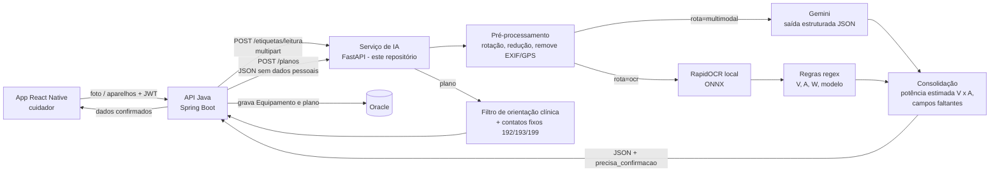

# Luz Vital — Serviço de IA

**Global Solution 2026/2 · CitizenTech · Disruptive Architectures: IoT, IoB & Generative IA**
Grupo **Mind-Dev** · 2TDS

Este repositório tem duas partes:

| Pasta | O que é |
|---|---|
| raiz (`app/`, `avaliacao/`, `dados/`) | **Serviço de IA** (Python/FastAPI + Gemini): leitura da etiqueta por foto e plano de contingência. Entrega da disciplina de IoT, descrita neste README |
| [`web/`](web/README.md) | **Front-end web** (HTML, CSS e JS, identidade inspirada no Carbon/IBM): telas do cuidador e do gestor, mapa, painel de impacto, PWA offline e simulador de apagão |

| Integrante | RM |
|---|---|
| Hebert Lopes do Santos | 563192 |
| Nicolas Monteiro Ramiro | 562380 |
| Marcus Vinícius Vila Nova da Silva | 558771 |
| Bruno Ferreira | 563489 |
| Gabriel Robertoni Padilha | 566293 |

## 1. O problema e a funcionalidade de IA

O Luz Vital cadastra pessoas que dependem de aparelhos elétricos para viver (ventilador, concentrador
de oxigênio, bomba de infusão, aspirador, diálise) e, quando a luz cai, ordena o socorro pelas horas
de bateria que restam em cada casa. Em outubro de 2024, mais de 3 milhões de imóveis ficaram sem luz
na Grande São Paulo; em dezembro de 2025, outro apagão durou dias.

**Público beneficiado:** cuidadores familiares, muitas vezes idosos, que não sabem de cabeça a potência
nem a autonomia do aparelho, e as equipes (Defesa Civil, atenção domiciliar, distribuidora) que
precisam desses números para decidir quem atender primeiro.

Este serviço entrega duas funções de IA ao app:

1. **Leitura da etiqueta por foto (visão computacional + IA generativa multimodal).** O cuidador
   fotografa a placa de dados do aparelho e recebe fabricante, modelo, tensão, corrente e potência em
   JSON. Sem digitar, sem errar o número que define o tamanho do gerador.
2. **Plano de contingência (IA generativa).** A partir dos aparelhos cadastrados, o modelo escreve um
   plano simples por faixa de tempo: o que fazer na primeira meia hora, quando pedir ajuda e para onde ir.

**Contribuição para a solução:** a potência define o gerador ou a bateria externa; a autonomia define a
contagem regressiva que ordena a fila do gestor. A foto torna esses dados confiáveis no cadastro, e o
plano dá à família um roteiro que funciona mesmo sem sinal (o app guarda o plano no celular).

## 2. Arquitetura



Fluxo da leitura:

1. A API Java recebe a foto do app e repassa ao serviço (`POST /etiquetas/leitura`).
2. O serviço valida tipo e tamanho, corrige a rotação, reduz para 1600 px e **regrava o JPEG sem EXIF**
   (a localização do celular não sai da API).
3. Na rota `multimodal`, a imagem vai ao Gemini com um *prompt* de extração e um `response_schema`
   Pydantic: a resposta já chega como JSON validado.
4. Na rota `ocr`, o RapidOCR (modelos de detecção e reconhecimento de texto, rodando local em ONNX)
   devolve as linhas e regras de regex extraem tensão, corrente, potência e modelo.
5. As duas rotas passam pela mesma consolidação: se a etiqueta traz só volts e ampères, a potência é
   calculada como V × A (potência aparente, pior caso: menor tensão × maior corrente) e marcada como
   `potencia_estimada: true`.
6. A resposta sempre volta com `precisa_confirmacao: true`. O app mostra os campos para o cuidador
   confirmar ou corrigir.

Fluxo do plano:

1. A API Java envia só os aparelhos (tipo, modelo, potência, autonomia, suporte à vida, fonte reserva).
   Nome, CPF e endereço do paciente **não** saem da API Java.
2. O serviço calcula o tempo crítico de forma determinística: menor autonomia entre os aparelhos de
   suporte à vida. A IA não decide esse número.
3. O Gemini escreve o plano em JSON (`etapas` por faixa de tempo, `quando_pedir_ajuda`, `sinais_alerta`).
4. Um filtro remove ações com conduta clínica (dose, medicação, ajuste de fluxo). Os contatos
   (192, 193, 199, distribuidora) e o aviso legal são fixos no código, não gerados.
5. Se a IA estiver fora do ar, sem chave ou sem cota, o serviço devolve um plano padrão
   (`origem: "modelo_padrao"`). O cuidador nunca fica sem plano.

## 3. Modelos, tecnologias e justificativas

| Escolha | Por quê |
|---|---|
| **Gemini (`gemini-3.5-flash-lite`, configurável em `GEMINI_MODEL`)** | Modelo multimodal: lê a imagem e devolve JSON no schema pedido (`response_schema`). Tem camada gratuita na API, viável para o grupo. A versão Flash tem latência baixa para uso no cadastro. |
| **Saída estruturada com Pydantic** | O mesmo schema valida a resposta da IA e documenta a API no Swagger. Resposta fora do formato vira erro tratado, não dado errado no banco. |
| **RapidOCR (ONNX, local)** | Rota de comparação e de contingência: roda sem internet e sem custo, instala só com `pip` (sem binário do Tesseract). |
| **Regras de regex** | Transformam texto em campos de forma auditável: faixa de tensão → menor valor, faixa de corrente → maior valor, mA → A, kW → W. |
| **FastAPI** | Swagger automático em `/docs`, validação de entrada e fácil de chamar pela API Java. |

### Aprofundamento escolhido: visão computacional

Comparamos duas rotas para a mesma tarefa, ler a placa de dados:

- **OCR + regras:** pipeline clássico de visão computacional (detecção de texto → reconhecimento →
  pós-processamento por regras). Previsível, local, gratuito; depende do texto seguir padrões
  ("MODELO:", "220 V", "1,5 A").
- **Leitura direta pelo modelo multimodal:** o modelo entende o layout da etiqueta e o significado
  dos campos, inclusive quando o rótulo vem em inglês, abreviado ou sem rótulo.

A escolha da rota padrão é feita pelos números da seção 5. O serviço expõe as duas
(`?rota=multimodal` ou `?rota=ocr`), e a API Java pode cair para OCR quando o Gemini responder 503.

## 4. Dados

| Conjunto | Origem | Uso |
|---|---|---|
| `dados/fotos/` + `dados/gabarito.csv` | 30 a 50 fotos de etiquetas tiradas pelo grupo, com o valor correto anotado à mão | Avaliação principal |
| `dados/sinteticas/` | 33 etiquetas geradas por `avaliacao/gerar_sinteticas.py` (semente fixa), com 4 condições de falha | Testar o pipeline e isolar o efeito de cada falha |
| Fichas técnicas Philips Trilogy Evo e EverFlo | Sites do fabricante (ver documentação do projeto) | Gabarito de dois modelos reais |

Como as fotos são coletadas e anotadas está em [docs/protocolo-fotos.md](docs/protocolo-fotos.md).
Colunas do gabarito: `arquivo, condicao, legivel, fabricante, modelo, potencia_w`. A condição é uma
de `normal`, `borrada`, `reflexo`, `parcial`, `so_va` (só volts e ampères) ou `nao_etiqueta`. O
gabarito registra o que está **impresso** na etiqueta; para `so_va`, `potencia_w` é V × A.

**Preparação:** cada foto passa pelo mesmo pré-processamento da API (rotação pelo EXIF, redução para
1600 px, regravação sem metadados).

## 5. Avaliação

**Métricas** (por rota e por condição da foto):

- **Acerto de potência:** diferença de até 0,5 W para o gabarito (acerto exato).
- **Acerto de modelo e de fabricante:** igualdade após normalizar caixa, espaços, hífens e acentos.
- **Legibilidade:** a rota disse corretamente se a imagem é uma etiqueta legível.
- **Potência inventada:** quantas vezes a rota devolveu potência onde o gabarito não tem nenhuma
  (alucinação; o número mais perigoso para este público).
- **Tempo médio** por foto.

```bash
python -m avaliacao.avaliar --gabarito dados/gabarito.csv --pasta dados/fotos --titulo "Fotos reais"
```

O script grava `avaliacao/resultados/predicoes_<rota>.csv` (uma linha por foto) e
`avaliacao/resultados/relatorio.md` (tabela por condição).

### Resultado já medido: etiquetas sintéticas, rota OCR

Rodado em 12/11/2026 (`avaliacao/resultados/sinteticas/relatorio.md`):

| condição | fotos | potência | modelo | fabricante | potência inventada |
|---|---|---|---|---|---|
| geral | 33 | 75% (24/32) | 69% (22/32) | 59% (19/32) | 0 |
| normal | 6 | 100% | 100% | 100% | 0 |
| borrada | 8 | 50% | 62% | 50% | 0 |
| reflexo | 8 | 75% | 75% | 88% | 0 |
| parcial | 8 | 75% | 38% | 0% | 0 |
| só V e A | 2 | 100% (estimada) | 100% | 100% | 0 |

**Leitura:** com foto boa, OCR + regras acerta tudo; o borrão é a falha que mais derruba a potência,
e o corte lateral apaga fabricante e modelo. A regra de V × A funcionou nos dois casos. Nenhuma
potência foi inventada. O OCR leva cerca de 2,4 s por foto em CPU comum.

### Resultado já medido: etiquetas sintéticas, rota multimodal (`gemini-3.5-flash-lite`)

Rodado em 12/11/2026 com pausa de 6 s entre fotos. 31 das 33 fotos responderam; 2 chamadas falharam
por erro do serviço e foram descartadas.

| condição | fotos | potência | modelo | fabricante | potência inventada |
|---|---|---|---|---|---|
| geral | 31 | 93% (28/30) | 87% (26/30) | 80% (24/30) | 0 |
| normal | 5 | 100% | 100% | 100% | 0 |
| borrada | 7 | 100% | 100% | 100% | 0 |
| reflexo | 8 | 100% | 100% | 100% | 0 |
| parcial | 8 | 75% | 50% | 25% | 0 |
| só V e A | 2 | 100% (estimada) | 100% | 100% | 0 |

**Comparação e escolha.** A leitura direta pelo modelo multimodal acertou a potência em 93% das fotos,
contra 75% do OCR + regras. A diferença vem do borrão (100% contra 50%) e do reflexo (100% contra 75%):
o modelo lê o texto degradado pelo contexto da etiqueta. Na etiqueta cortada, as duas rotas perdem
fabricante e modelo, porque a informação não está na foto. Nenhuma das rotas inventou potência. Por
isso a **rota multimodal é a padrão**, e o OCR fica como contingência sem internet. O custo é a
latência: cerca de 3,7 s por foto, contra 3 s do OCR em CPU.

**Cota.** Nos testes, a camada gratuita do `gemini-3.8-flash` esgotou depois de poucas dezenas de
chamadas, e o `gemini-3.6-flash` respondeu 503 (alta demanda). Por isso o padrão em `.env.example` é
o `gemini-3.5-flash-lite`.

### Resultado com fotos reais

> Preencher depois de coletar as fotos do grupo ([protocolo](docs/protocolo-fotos.md)) e rodar o
> comando acima. Copiar a tabela de `avaliacao/resultados/relatorio.md` e comparar com a seção anterior.

### Exemplo de plano gerado pela IA

[docs/exemplo-plano.json](docs/exemplo-plano.json): concentrador sem bateria com cilindro reserva e
ventilador com 15 h. Saiu com `origem: "ia"`, 4 faixas de tempo e nenhuma ação removida pelo filtro clínico.

## 6. Como executar

Pré-requisito: Python 3.11 ou mais novo.

```bash
python -m venv .venv
# Windows: .venv\Scripts\activate    Linux/macOS: source .venv/bin/activate
pip install -r requirements-dev.txt
cp .env.example .env        # e coloque sua GEMINI_API_KEY
uvicorn app.main:app --reload --port 8000
```

Swagger: <http://localhost:8000/docs>

```bash
# leitura da etiqueta
curl -F "foto=@dados/sinteticas/sint_01_normal.jpg" "http://localhost:8000/etiquetas/leitura?rota=multimodal"
curl -F "foto=@dados/sinteticas/sint_01_normal.jpg" "http://localhost:8000/etiquetas/leitura?rota=ocr"

# plano de contingência
curl -X POST http://localhost:8000/planos -H "Content-Type: application/json" -d '{
  "aparelhos": [
    {"tipo": "Concentrador de oxigênio", "modelo": "EverFlo", "potencia_w": 320,
     "autonomia_min": 0, "suporte_vida": true, "fonte_reserva": "cilindro_oxigenio"},
    {"tipo": "Ventilador mecânico", "modelo": "Trilogy Evo", "autonomia_min": 900, "suporte_vida": true}
  ],
  "bairro": "Capão Redondo"
}'
```

Testes automatizados (não chamam o Gemini nem gastam cota; usam dublês):

```bash
pytest --cov=app
```

Etiquetas sintéticas e avaliação:

```bash
python -m avaliacao.gerar_sinteticas
python -m avaliacao.avaliar --gabarito dados/sinteticas/gabarito.csv --pasta dados/sinteticas --saida avaliacao/resultados/sinteticas
```

### Contrato da API

| Método e rota | Entrada | Saída | Erros |
|---|---|---|---|
| `GET /health` | — | `status`, `ia_configurada`, `modelo` | — |
| `POST /etiquetas/leitura?rota=multimodal\|ocr` | `foto` (multipart, JPEG/PNG/WebP, até 8 MB) | `ResultadoLeitura` | 413 foto grande, 415 tipo errado, 422 imagem corrompida, 503 IA indisponível |
| `POST /planos` | `PedidoPlano` (1 a 10 aparelhos) | `PlanoContingencia` | 422 entrada inválida (autonomia negativa, potência ≤ 0) |

Chamada pela API Java (Spring `RestClient`):

```java
MultiValueMap<String, Object> corpo = new LinkedMultiValueMap<>();
corpo.add("foto", new ByteArrayResource(bytes) { public String getFilename() { return "etiqueta.jpg"; } });
LeituraEtiquetaDto leitura = restClient.post()
    .uri(iaUrl + "/etiquetas/leitura?rota=multimodal")
    .contentType(MediaType.MULTIPART_FORM_DATA)
    .body(corpo)
    .retrieve()
    .body(LeituraEtiquetaDto.class);
```

## 7. Uso responsável e limitações

**Credenciais e dados pessoais**

- A chave do Gemini fica só no `.env`, que está no `.gitignore`. O repositório tem apenas `.env.example`.
- A foto é regravada sem EXIF antes de sair da API (sem GPS, sem dados do celular) e não é armazenada.
- O *prompt* manda ignorar número de série, nome e endereço; o plano recebe só dados dos aparelhos.
- As fotos do conjunto de avaliação mostram só a etiqueta, sem pessoas, documentos ou endereços.
- Saúde é dado sensível pela LGPD: o projeto usa pacientes fictícios.

**Limites da IA**

- **A leitura erra.** Borrão, reflexo e etiqueta cortada reduzem o acerto (ver seção 5). Por isso o
  cuidador sempre confirma os campos, e o app aceita digitação manual.
- **A potência estimada é aproximada.** V × A dá potência aparente (VA) no pior caso; o consumo real
  costuma ser menor. Serve para dimensionar gerador com folga, não para a conta de luz.
- **A autonomia da bateria não está na etiqueta.** O cuidador informa; a IA não adivinha.
- **O plano não é orientação clínica.** Não traz dose, medicação nem ajuste de parâmetros; um filtro
  remove esse tipo de frase e os telefones são fixos no código. O texto não substitui o 192, o 193
  nem o canal da distribuidora.
- **A regra de prioridade é hipótese de projeto**, a validar com profissional de saúde.
- **Dependência de rede.** Sem internet, a rota multimodal responde 503: a API Java usa a rota OCR,
  e o plano cai para o modelo padrão.
- **Cota gratuita.** A camada gratuita do Gemini limita requisições por minuto; o script de avaliação
  espera 4 s entre chamadas (`--pausa`).

## 8. Estrutura

```
web/            front-end web (ver web/README.md)
app/            serviço FastAPI (config, imagem, gemini, leitura, regras, plano, schemas, main)
avaliacao/      gerador de etiquetas sintéticas, métricas e script de avaliação
dados/          fotos reais + gabarito.csv; etiquetas sintéticas
docs/           protocolo de coleta das fotos
tests/          testes unitários e de API (pytest)
```

## 9. Declaração de uso de IA

Parte do código e da documentação foi escrita com apoio do assistente Claude (Anthropic) e revisada
pelo grupo. O funcionamento do serviço usa o Gemini (Google) como descrito acima.
